<h3><code>pratham@github ~ $ ./contributions.sh</code></h3>

  

<h3><code>pratham@github ~ $ whoami</code></h3>
<table>
  <tr>
    <td valign="top"></td>
    <td valign="top"></td>
  </tr>
</table>

  

<h3><code>pratham@github ~ $ ls ~/projects</code></h3>

<a href="https://github.com/Pratham1227-beep/product-substitution-system"><code>product-substitution-system</code></a> · knowledge-graph product substitution (Streamlit) 
<a href="https://github.com/Pratham1227-beep/ai-study-pal"><code>ai-study-pal</code></a> · AI study assistant: plans, quizzes, summaries 
<a href="https://github.com/Pratham1227-beep/test-score-predictor-using-ml-concepts"><code>test-score-predictor-using-ml-concepts</code></a> · test score prediction with classic ML 
<a href="https://github.com/Pratham1227-beep/study-mentor-v1.0"><code>study-mentor-v1.0</code></a> · study mentor app

  

<h3><code>pratham@github ~ $ ./contact.sh</code></h3>

<a href="mailto:prathamdkhatri@gmail.com">prathamdkhatri@gmail.com</a>

